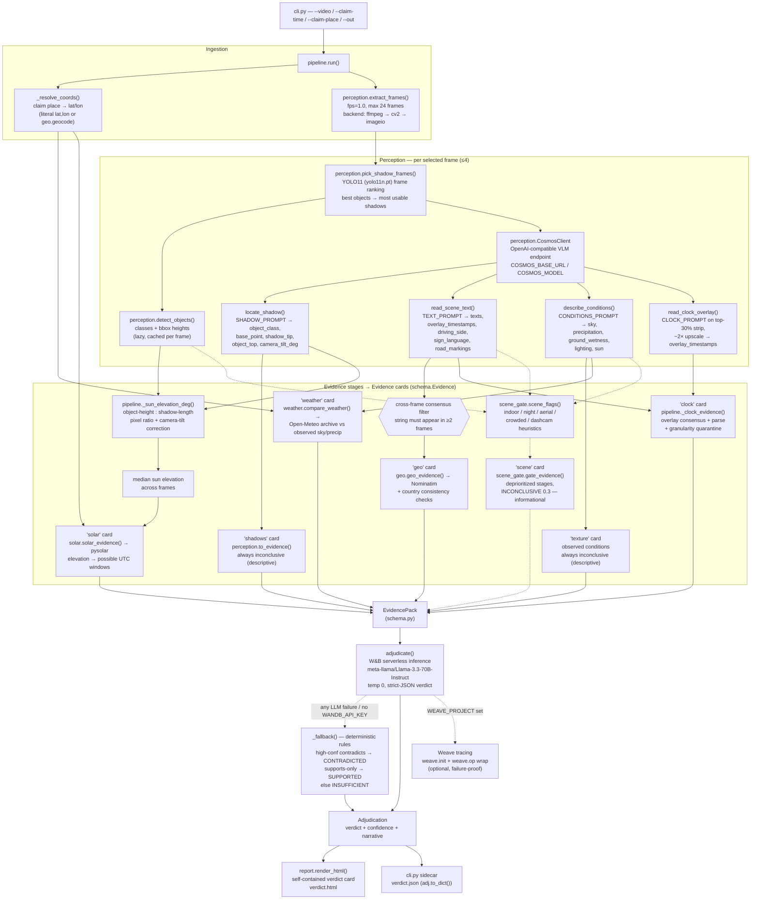

# Sundial — Architecture

Sundial is a video-provenance verification agent. Input: a short clip plus a
natural-language *claim* about when and where it was filmed
(`--claim-time '2026-10-17T12:30:00' --claim-place 'Husum, Germany'`).
The pipeline (`sundial/pipeline.py::run`) resolves the claim to coordinates,
samples frames, extracts forensic signals from them (shadow geometry, scene
text, ambient conditions, burned-in clock overlays), and feeds each signal
through an independent check against a ground-truth source: pysolar for sun
position, Open-Meteo for weather, Nominatim/OSM for place names, and the
camera's own overlay for its timestamp. Every check emits an `Evidence` card
carrying its own per-claim verdict and confidence; all cards are collected in
an `EvidencePack` and handed to an LLM adjudicator (W&B serverless
Llama-3.3-70B, with a deterministic rule fallback) that weighs the evidence
and returns `SUPPORTED` / `CONTRADICTED` / `INSUFFICIENT` plus a narrative.
The claim → evidence → verdict loop is deliberately asymmetric: evidence
stages may only *speak to* the claim (`supports` / `contradicts` /
`inconclusive` per card), and the single adjudication step — never a stage —
decides the verdict, so a noisy or hallucinating stage degrades to
`inconclusive` rather than corrupting the result.

## Component diagram



Stage-unavailable paths are omitted for readability: every stage is wrapped
and, on failure, contributes an `INCONCLUSIVE` "stage unavailable" card via
`pipeline._note()` instead of aborting the run.

Dotted edges mark components present in the repo but **not yet invoked by
`pipeline.run`**: `sundial/scene_gate.py` (scene flags → per-stage
applicability → an informational `scene` card), plus the hardening modules
listed in the file map (`shadow_measure`, `horizon`, `azimuth`, `ocr`,
`plate_style`, `audio_probe`, `provenance`, `cache`). They are written to
the same `Evidence` contract, so wiring them in adds cards, not new
plumbing.

## The evidence contract

Defined in `sundial/schema.py`. It is the only interface between stages and
the adjudicator — stages never see each other's output.

```python
@dataclass
class Evidence:
    type: str            # "solar" | "weather" | "geo" | "clock" | "shadows" | "texture"
                         # | stage-unavailable notes: "geo-resolve" | "frames" | "vlm"
                         # | "weather+solar" | the failed stage's name
    summary: str         # one-sentence human-readable finding
    verdict: ClaimVerdict
    confidence: float    # 0..1
    data: dict           # stage-specific payload (raw API results, vectors, windows…)
    frames: list         # cited frame paths — what the card is grounded in
```

`ClaimVerdict` is per-evidence, deliberately weaker than the final `Verdict`:

| ClaimVerdict | Meaning |
|---|---|
| `supports` | this item is consistent with the claim |
| `contradicts` | this item is inconsistent with the claim |
| `inconclusive` | this item cannot speak to the claim |

`Verdict` (`SUPPORTED` / `CONTRADICTED` / `INSUFFICIENT`) exists only on
`Adjudication` — the adjudicator's call over the whole pack.

The evidence types a pack can contain:

| `type` | Producer | Ground truth | Positions it may take |
|---|---|---|---|
| `solar` | `solar.solar_evidence` via `pipeline._sun_elevation_deg` + median | pysolar ephemeris | supports / contradicts / inconclusive |
| `weather` | `weather.compare_weather` | Open-Meteo archive vs observed sky/precip/wetness | supports / contradicts / inconclusive |
| `geo` | `geo.geo_evidence` on ≥2-frame consensus text | Nominatim/OSM + country heuristics | supports / contradicts / inconclusive |
| `clock` | `pipeline._clock_evidence` | camera's burned-in overlay vs claimed local time | supports / contradicts / inconclusive (time-only reads capped at inconclusive) |
| `shadows` | `perception.to_evidence` per VLM shadow observation | — | inconclusive only (descriptive) |
| `texture` | `pipeline` conditions card | — | inconclusive only (descriptive) |
| `scene` | `scene_gate.gate_evidence` *(defined; not yet wired into `pipeline.run`)* | — | inconclusive only (informational — deprioritizes stages, never votes) |
| `audio` / `plate_style` / `lunar` | `audio_probe.audio_evidence` / `plate_style.plate_evidence` / `moonphase.moon_evidence` *(defined; not yet wired)* | ambience FFT heuristics / plate-band pixel sampling / mean-lunation phase math | per module docstrings |
| stage names / `geo-resolve` / `frames` / `vlm` / `weather+solar` | `pipeline._note` | — | inconclusive at conf 0.0 (stage unavailable or prerequisites missing) |

Why `INCONCLUSIVE` is a first-class, failure-isolated value:

- **Stage isolation.** `pipeline.run` wraps every stage; an exception routes
  through `_note()` (pipeline.py:18) → an `INCONCLUSIVE` card at confidence
  0.0 with the error in `data`. `geo.geo_evidence` and
  `weather.compare_weather` additionally convert API failures into
  `INCONCLUSIVE` cards internally, and `CosmosClient` methods never raise
  (they return `None`/`{}`). A pack therefore always reaches the adjudicator,
  and the adjudicator can see which stages actually contributed.
- **Descriptive stages are inconclusive by construction.** `shadows` cards
  (`to_evidence`) and the `texture` card carry `INCONCLUSIVE` always — they
  describe what was seen, not whether the claim is true; only fused checks
  (solar, weather, geo, clock) may take a position.
- **Honest abstention is load-bearing.** `INSUFFICIENT` at the adjudicator is
  what you get when the pack is thin or mixed — it is an intended output, not
  an error path.

## Hallucination defenses

The VLM is a small reasoner and it fabricates text. The design assumes this:

1. **Cross-frame consensus before geocoding** (pipeline.py:338-353). Scene
   text is only geocoded if the identical string appears in **≥2 frames**
   (`Counter` over `texts`). Invented sign text does not repeat across
   frames; real text does. The filtered count is recorded on the card as
   `data["texts_filtered"]`.
2. **Time-only overlay strings are quarantined** (`_clock_evidence` /
   `_parse_overlay_time`, pipeline.py:111-210). The same ≥2-frame string
   consensus applies to overlay reads, with a majority-timestamp pick. Parse
   granularity matters: a string matching only bare `HH:MM` gets granularity
   `"time"` and its verdict is forced to `INCONCLUSIVE` at 0.3 regardless of
   how well it matches — *a clock without a date can never carry a verdict*.
   Full date+time reads can `SUPPORTS` (≤45 min off, conf 0.85) or
   `CONTRADICTS` (wrong date, or ≥90 min off, conf 0.9); the 45–90 min grey
   zone is `INCONCLUSIVE` at 0.5. Claim and overlay are both local-to-place,
   so no timezone math is involved.
3. **Stage isolation** (above): one bad call cannot crash the run or inject a
   fake confident verdict — the worst it contributes is an `INCONCLUSIVE`
   card at confidence 0.
4. **Honest `INSUFFICIENT`.** `solar.solar_evidence` returns `INCONCLUSIVE`
   when the observed elevation cannot be placed anywhere on the claimed date
   (the estimate is too noisy to accuse or confirm — e.g. the 08:00-lie
   webcam case in the README results table). The adjudicator system prompt
   (`adjudicate.SYSTEM_PROMPT`) instructs `INSUFFICIENT` whenever evidence is
   missing, inconclusive, or mixed; the rule fallback encodes the same shape
   (`_fallback`: `CONTRADICTED` needs a `contradicts` card at conf ≥ 0.6;
   `SUPPORTED` needs support with zero contradictions).
5. **Prompt-level hygiene** (`prompts.py`). All four prompts demand strict
   JSON; `TEXT_PROMPT` states *"an empty list is a perfectly good answer —
   never invent text"*; `CLOCK_PROMPT` demands verbatim transcription with no
   completion of missing digits. Responses are parsed by a tolerant
   `_first_json_object` (perception.py / adjudicate.py) that strips fences
   and prose. All VLM calls run at `temperature=0.0`.
6. **Dedicated clock read.** Burned-in timestamps hug frame edges at a few
   dozen pixels; a full-frame read guesses. `read_clock_overlay` re-asks with
   the top 30% of the frame cropped and upscaled ~2×
   (`_data_url(top_fraction=0.3)`), which is what turned "can't read it" into
   verbatim reads like `17.10.26 12:30` during development.

Additionally, the repo carries classical-CV second opinions on the VLM's
weakest spots — `shadow_measure` (re-measures shadow length from pixels),
`horizon` (recovers camera tilt from vanishing points instead of trusting
the VLM's `camera_tilt_deg`), `ocr` (tesseract fallback for overlay text)
and `scene_gate` (deprioritizes stages the scene can't support). They are
written but not yet invoked by `pipeline.run` (see the file map).

## Physics notes

- **Pixel-ratio sun elevation** (`pipeline._sun_elevation_deg`, line 52).
  For a vertical object on flat ground,
  `elev ≈ atan2(object_px_height, shadow_px_length)` — the object's real
  height cancels out, so no metric calibration is needed. The VLM reports
  `object_class`; it is matched to YOLO detections by class-name overlap and
  the tallest matching bbox supplies `object_px_height`.
- **Camera-tilt correction** (pipeline.py:74-87). Elevated cameras
  foreshorten the ground plane along the image vertical by `sin(tilt)`. The
  VLM estimates `camera_tilt_deg` per frame; when tilt > 8°, the shadow
  vector's `dy` is expanded by `dy / max(sin(tilt), 0.3)` before the length
  is measured (the 0.3 floor prevents blowup near-horizontal). Without this,
  elevated-webcam estimates ran ~20° too high.
- **Median across frames** (pipeline.py:376-379). Per-frame elevations go
  through a median before reaching the solar stage — single-frame VLM point
  picks are noisy at the ~25 px object sizes these cameras resolve.
- **UTC window inversion** (`solar.infer_time_window`). Rather than checking
  the claimed instant only, the stage scans the whole claimed UTC day in
  2-minute steps and merges contiguous times whose expected elevation is
  within ±3° of observed (±8° on azimuth when one is supplied — the pipeline
  currently passes elevation only, since shadow azimuth stays in image
  space). The card carries the matched `windows_utc` so the report shows
  *when the clip could have been filmed*, not just pass/fail.
- **Twilight / night-claim handling** (`solar.solar_evidence`).
  - Claimed time puts the sun **below −6°** (past civil twilight) but a real
    cast shadow was measured → `CONTRADICTS`, conf 0.9 if ≥12° below else
    0.7 — cast shadows require daylight.
  - Claimed sun in **(−6°, 0°)** twilight band → `INCONCLUSIVE` at 0.3:
    shadows can persist just after sunset, so the check abstains.
  - Observed elevation **placeable nowhere** on the date → `INCONCLUSIVE` at
    0.3 rather than a forced contradiction.
  - Consistent within tolerance → `SUPPORTS` at `0.6 + 0.35·margin`;
    mismatch → `CONTRADICTS` at `min(0.95, 0.5 + e_err/(4·tol))`.
- **Local→UTC conversion** (`pipeline._claimed_utc`). Claimed local time is
  converted using `utc_offset_seconds` from the Open-Meteo archive response
  (which is queried with `timezone=auto`); on lookup failure the claim is
  treated as UTC and the fallback is recorded in `data["claim_tz_note"]`.

## Deployment / run notes

Runtime: Python ≥ 3.10. Install: `pip install -r requirements.txt`
(pysolar, ultralytics, openai, requests, Pillow, weave) or
`pip install .` (console script `sundial`).

```bash
export COSMOS_BASE_URL=http://<cosmos-nim>/v1   # required for VLM stages
export COSMOS_API_KEY=<bearer>                  # default "not-needed"
export COSMOS_MODEL=nvidia/cosmos3-nano-reasoner # code default: nvidia/cosmos-reason2
export WANDB_API_KEY=<key>                      # required for LLM adjudication
# optional:
export WANDB_BASE_URL=https://api.inference.wandb.ai/v1   # default
export WANDB_MODEL=meta-llama/Llama-3.3-70B-Instruct      # default
export WEAVE_PROJECT=vastdata/sundial           # enables Weave tracing

python3 -m sundial.cli \
    --video clip.mp4 \
    --claim-time '2026-10-17T12:30:00' \
    --claim-place 'Husum, Germany' \
    --out verdict.html
```

- `--claim-place` accepts free text (geocoded) or a literal `lat,lon`.
- Outputs: `--out` HTML report (self-contained, no external assets) **plus a
  JSON sidecar** at `<out-stem>.json` (`Adjudication.to_dict()`), and a JSON
  summary on stdout.
- `--no-vlm` skips all Cosmos calls; `--frames-dir` relocates the frame cache
  (default `.sundial_frames`); `--demo` adjudicates a fabricated pack with
  zero dependencies (smoke test for report + adjudicator + fallback).
- Frame extraction backend order: `ffmpeg` binary → `imageio-ffmpeg` bundled
  binary → `cv2` → `imageio`; pipeline samples at `fps=1.0`, ≤24 frames.
- VLM budget: ≤4 frames per run (`max_vlm_frames=4`), 4 Cosmos calls per
  frame; a full run takes ~2–4 min (DEMO.md).
- External services: Nominatim (no key; module-level limiter holds
  ≤1 req/s and sends an identifying User-Agent), Open-Meteo archive (no key;
  lags ~5 days — too-recent dates return nulls and degrade to
  `INCONCLUSIVE`), W&B serverless inference, and the Cosmos NIM endpoint.
- `sundial/sources.py` is dev tooling, not in the verify path: fetchers for
  foto-webcam.eu dated frames, the TfL JamCam catalogue, and the hackathon
  VAST S3 clip corpus (`python -m sundial.sources --help`).

## File map

| Path | Role |
|---|---|
| `sundial/schema.py` | Contract types: `Claim`, `Evidence`, `ClaimVerdict`, `EvidencePack`, `Adjudication`, `Verdict`, `GeoCandidate` |
| `sundial/pipeline.py` | Orchestration: coord resolve → frames → VLM loop → geo/clock/weather/solar stages → adjudication; houses consensus filters, clock quarantine, tilt-corrected elevation, `_note` isolation |
| `sundial/perception.py` | `extract_frames` (ffmpeg/cv2/imageio), `detect_objects` (YOLO11n), `CosmosClient` (4 VLM reads), `shadow_vector`, `to_evidence`, `pick_shadow_frames` (frame ranking) |
| `sundial/prompts.py` | Strict-JSON prompts: `SHADOW_PROMPT`, `TEXT_PROMPT`, `CONDITIONS_PROMPT`, `CLOCK_PROMPT` |
| `sundial/solar.py` | pysolar wrappers: `sun_position`, `infer_time_window`, `solar_evidence`, `elevation_from_shadow`, `azimuth_error` |
| `sundial/weather.py` | Open-Meteo archive client + `compare_weather` assessment vs clip observations (WMO code table) |
| `sundial/geo.py` | Nominatim geocoding, `geocode_texts` frequency ranking, `geo_evidence`, country consistency checks (driving side, plates, language, markings), haversine |
| `sundial/adjudicate.py` | `WandBClient`, `SYSTEM_PROMPT` trust hierarchy, robust JSON extraction, `_fallback` rule adjudicator, optional `weave.op` wrap |
| `sundial/report.py` | `render_html` — self-contained animated verdict card; `_sun_viz` SVG sun diagram for solar cards |
| `sundial/cli.py` | Argparse entry; writes `.json` sidecar; `--demo` fabricated pack |
| `sundial/sources.py` | Test-media fetchers: foto-webcam.eu, TfL JamCam, VAST S3 (boto3) |
| `sundial/__main__.py` | `python -m sundial` → `cli.main` |
| `tests/` | `test_solar.py`, `test_adjudicate.py`, `test_geo_weather.py`, `test_clock.py`, `test_pipeline_units.py`, `test_report.py` |

### Auxiliary modules — in repo, not yet invoked by `pipeline.run`

Written to the same `Evidence` contract; adding them to the pipeline is a
matter of calling them and `pack.add()`-ing the result, not new plumbing.

| Path | Role |
|---|---|
| `sundial/scene_gate.py` | Scene-flag heuristics (indoor / night / aerial / crowded / dashcam) → per-stage applicability map → informational `scene` card |
| `sundial/shadow_measure.py` | Classical-CV shadow-length re-measurement (cv2/numpy, lazy) — second opinion on the VLM's base/tip picks |
| `sundial/horizon.py` | Camera-tilt from frame geometry: Canny → Hough → vanishing-point horizon row (replaces the VLM's `camera_tilt_deg` guess) |
| `sundial/azimuth.py` | Image-space shadow angle → world azimuth bridge; camera-heading hypotheses via consistent azimuth windows |
| `sundial/ocr.py` | Tesseract fallback for overlay text (top/bottom strips), timestamp regex extraction |
| `sundial/plate_style.py` | `plate_evidence` — EU blue-band / UK yellow-rear plate cue via pure-PIL pixel sampling of vehicle bboxes |
| `sundial/audio_probe.py` | `audio_evidence` — ffprobe/ffmpeg → stdlib FFT ambience heuristics (traffic hum, birdsong, silence); always inconclusive |
| `sundial/moonphase.py` | `moon_evidence` — mean-lunation phase math vs claimed date (and vs observed moon in night clips); `lunar` card |
| `sundial/provenance.py` | `tag()` stamps `data["channel"]` (visual / external / derived / ground-truth) per card for report badges |
| `sundial/cache.py` | `VLMCache` / `wrap_cosmos_client` — file memoization of Cosmos calls keyed on frame-bytes + prompt; `SUNDIAL_NO_CACHE=1` bypasses |
| `sundial/stills.py` | Still-image / folder-of-stills inputs → frame list; `loop_to_mp4` for container-requiring tools |
| `sundial/batch.py` | `python -m sundial.batch` — folder-of-clips audit against one claim → per-clip reports + leaderboard `index.html` |

## Limitations

Mirroring the README's honesty section, with the engineering detail:

- **Shadow-derived elevation is fragile.** It assumes a vertical object on
  flat, level ground and is sensitive to camera tilt, perspective, and small
  object sizes — ~25 px people give ±10° of noise. The median and the
  tolerance bands absorb some of this; when the estimate can't be placed the
  stage reports `INCONCLUSIVE` rather than guessing.
- **VLM fabrication is bounded, not eliminated.** The ≥2-frame consensus and
  time-only quarantine stop most injected text/timestamps, but on
  single-image or very short clips there is no consensus pool — a
  fabricated string can still reach geocoding, and a fabricated overlay can
  still be reported (it just can't carry a verdict without a date).
- **Weather corroborates; it does not prove.** Clear skies can't distinguish
  morning from noon on a clear day, and the Open-Meteo archive lags ~5 days,
  so recent clips can't be weather-checked at all.
- **Elevation-only inversion is symmetric about solar noon.** A given sun
  elevation generally occurs twice per day, so `windows_utc` can contain a
  morning and an afternoon window; the check verifies the claimed instant's
  consistency, it does not by itself disambiguate them. Shadow *azimuth* is
  extracted but stays in image space — `azimuth.py` carries the heading-
  hypothesis machinery (`consistent_azimuth_windows`, `heading_hint`) but
  isn't wired into `pipeline.run` yet.
- **Geo evidence is coarse.** Sign text must be legible and actually present;
  the consistency tables (driving side, plate style, language, markings) are
  country-level heuristics that can only corroborate, not pinpoint.
- **Adjudicator variance.** The LLM adjudicator is prompted with a trust
  hierarchy (clock/solar > geo/weather > descriptive cards) and constrained
  to strict JSON, but it is still an LLM — borderline packs can land on the
  `INSUFFICIENT`/`SUPPORTED` boundary differently run to run. The
  deterministic fallback exists so this variance is optional, not
  load-bearing.
